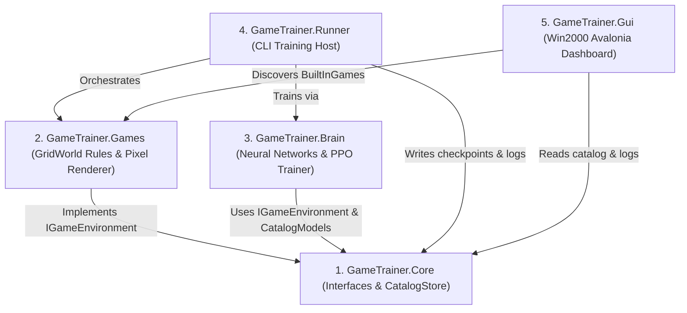
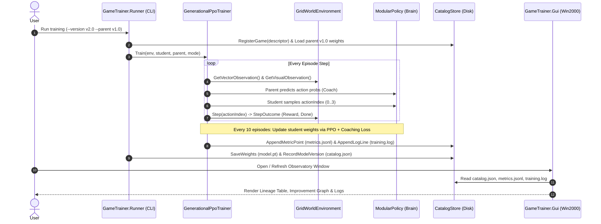
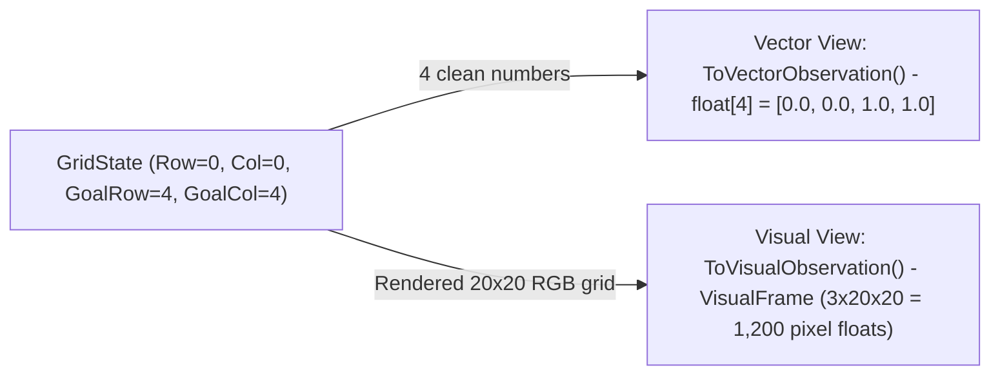
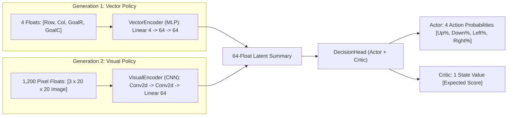
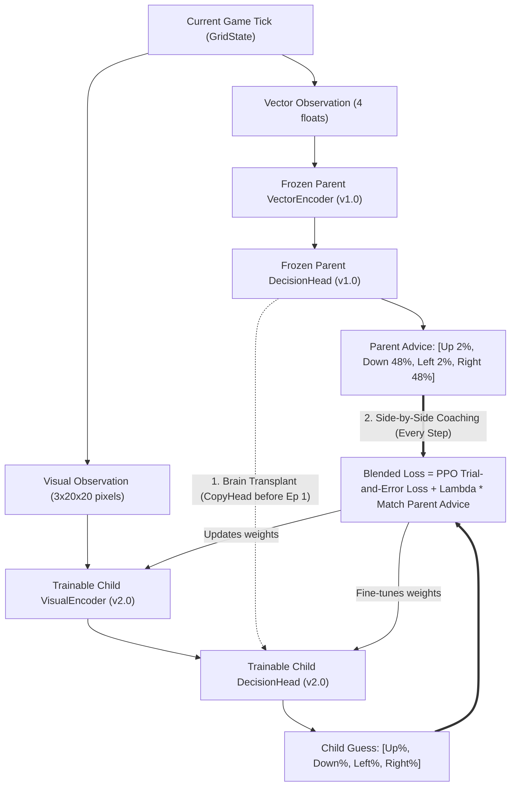

# GameTrainerSharp: Beginner's Walkthrough (OOP + ML)

This guide splits the project into two clear halves:
1. **Part 1 (OOP & Data Flow):** What each C# project/class does, the full UML class diagram, and how data moves between the CLI Runner, the Disk Store, and the GUI.
2. **Part 2 (Machine Learning Flow):** How Vector training works, how Visual training works, and how a Parent model teaches a Child model.

---

## Part 1: OOP & Data Flow (How the C# Classes Fit Together)

### 1. The 5 Projects in Your Solution (`src/`)

Think of each project as one box with one job:

* **[`GameTrainer.Core`](file:///C:/Users/phill/IdeaProjects/GameTrainerSharp/src/GameTrainer.Core)**: Holds interfaces (`IGameEnvironment`, `IGameDescriptor`) and [`CatalogStore`](file:///C:/Users/phill/IdeaProjects/GameTrainerSharp/src/GameTrainer.Core/Catalog/CatalogStore.cs) (which reads/writes `artifacts/catalog.json`).
* **[`GameTrainer.Games`](file:///C:/Users/phill/IdeaProjects/GameTrainerSharp/src/GameTrainer.Games)**: Holds the actual games (like [`GridWorldEnvironment`](file:///C:/Users/phill/IdeaProjects/GameTrainerSharp/src/GameTrainer.Games/GridWorld/GridWorldEnvironment.cs)).
* **[`GameTrainer.Brain`](file:///C:/Users/phill/IdeaProjects/GameTrainerSharp/src/GameTrainer.Brain)**: Holds the neural network ([`ModularPolicy`](file:///C:/Users/phill/IdeaProjects/GameTrainerSharp/src/GameTrainer.Brain/ModularPolicy.cs)) and the training loop ([`GenerationalPpoTrainer`](file:///C:/Users/phill/IdeaProjects/GameTrainerSharp/src/GameTrainer.Brain/GenerationalPpoTrainer.cs)).
* **[`GameTrainer.Runner`](file:///C:/Users/phill/IdeaProjects/GameTrainerSharp/src/GameTrainer.Runner/Program.cs)**: The terminal app that spins up a game + a brain, runs training, and saves the results to disk.
* **[`GameTrainer.Gui`](file:///C:/Users/phill/IdeaProjects/GameTrainerSharp/src/GameTrainer.Gui/MainWindow.cs)**: The Windows 2000 desktop window that reads the saved files from disk and displays your games, model versions, graphs, and logs.

---

### 1.5 UML Class Diagram (Interfaces, Implementations, Inheritance & Composition)

Here is how the actual classes, interfaces, and methods connect across all five projects:

* `..|>` = **Implements** an interface
* `--|>` = **Extends** (inherits from) a base class
* `*--` = **Composes / Owns** an inner object
* `-->` = **Calls / Observes / Uses** another object

```mermaid
classDiagram
    direction TB

    class IGameEnvironment {
        <<interface>>
        +EnvironmentSpec Spec
        +Reset() void
        +Step(int actionIndex) StepOutcome
        +GetVectorObservation() float[]
        +GetVisualObservation() VisualFrame
    }

    class IGameDescriptor {
        <<interface>>
        +string Id
        +string DisplayName
        +string Description
        +EnvironmentSpec Spec
        +CreateEnvironment(Random rng) IGameEnvironment
    }

    class ICatalogStore {
        <<interface>>
        +string RootDirectory
        +GetGames() IReadOnlyList~GameEntry~
        +RegisterGame(IGameDescriptor descriptor) GameEntry
        +RecordModelVersion(string gameId, ModelVersionEntry version) ModelVersionEntry
        +AppendMetricPoint(string gameId, string version, EpisodeMetricPoint point) void
        +ReadMetrics(string gameId, string version) IReadOnlyList~EpisodeMetricPoint~
        +AppendLogLine(string gameId, string version, string message) void
        +ReadTrainingLog(string gameId, string version) string
    }

    class CatalogStore {
        +string RootDirectory
        +GetGames() IReadOnlyList~GameEntry~
        +RegisterGame(IGameDescriptor descriptor) GameEntry
        +RecordModelVersion(string gameId, ModelVersionEntry version) ModelVersionEntry
        +ReadMetrics(string gameId, string version) IReadOnlyList~EpisodeMetricPoint~
        +ReadTrainingLog(string gameId, string version) string
    }

    class GridState {
        <<record>>
        +int Row
        +int Col
        +int GoalRow
        +int GoalCol
        +int Steps
        +bool AtGoal
        +ToVectorObservation() float[]
        +ToVisualObservation() VisualFrame
    }

    class GridWorldRules {
        <<static>>
        +Step(GridState state, Move move, RewardCalculator rewards) Tuple
    }

    class GridWorldEnvironment {
        +EnvironmentSpec Spec
        +GridState State
        +Reset() float[]
        +Step(int actionIndex) StepOutcome
        +GetVectorObservation() float[]
        +GetVisualObservation() VisualFrame
    }

    class RandomStartEnvironment {
        +EnvironmentSpec Spec
        +GridState State
        +Reset() float[]
        +Step(int actionIndex) StepOutcome
    }

    class GridWorldFixedDescriptor {
        +string Id
        +CreateEnvironment(Random rng) IGameEnvironment
    }

    class GridWorldRandomDescriptor {
        +string Id
        +CreateEnvironment(Random rng) IGameEnvironment
    }

    class TorchModule {
        <<TorchSharp.torch.nn.Module>>
    }

    class VectorEncoder {
        +int InputSize
        +int LatentDim
        +forward(Tensor x) Tensor
    }

    class VisualEncoder {
        +int Channels
        +int Height
        +int Width
        +int LatentDim
        +forward(Tensor x) Tensor
    }

    class DecisionHead {
        +int ActionCount
        +int LatentDim
        +forward(Tensor latent) Tuple
        +CopyWeightsFrom(DecisionHead source) void
    }

    class ModularPolicy {
        +EnvironmentSpec Spec
        +TrainingModality Modality
        +int LatentDim
        +DecisionHead Head
        +Encode(Tensor obsBatch) Tensor
        +ForwardTensor(Tensor obsBatch) Tuple
        +SampleAction(IGameEnvironment env, Random rng) Tuple
        +GetActionProbabilities(IGameEnvironment env) float[]
        +CopyDecisionHeadFrom(ModularPolicy parent) void
        +SaveWeights(string path) void
        +LoadWeights(string path) void
    }

    class GenerationalPpoTrainer {
        +Train(IGameEnvironment env, ModularPolicy student, ModularPolicy parent, GenerationalMode mode) TrainingSummary
        +Evaluate(IGameEnvironment env, ModularPolicy policy, int episodes) Tuple
    }

    class INotifyPropertyChanged {
        <<interface>>
        +PropertyChanged Event
    }

    class DashboardViewModel {
        +ObservableCollection~GameListItemViewModel~ Games
        +ObservableCollection~ModelVersionRowViewModel~ ModelVersions
        +GameListItemViewModel SelectedGame
        +ModelVersionRowViewModel SelectedModelVersion
        +AddSelectedGame() GameEntry
        +Refresh(string selectGameId) void
    }

    class MainWindow {
        +SyncFromViewModel() void
    }

    class ImprovementChartControl {
        +SetSeries(string versionLabel, IReadOnlyList~EpisodeMetricPoint~ metrics, string parentLabel, IReadOnlyList~EpisodeMetricPoint~ parentMetrics) void
        +Render(DrawingContext context) void
    }

    CatalogStore ..|> ICatalogStore : implements
    GridWorldEnvironment ..|> IGameEnvironment : implements
    RandomStartEnvironment ..|> IGameEnvironment : implements
    RandomStartEnvironment *-- GridWorldEnvironment : wraps
    GridWorldEnvironment *-- GridState : holds current state
    GridWorldEnvironment --> GridWorldRules : calls pure Step()

    GridWorldFixedDescriptor ..|> IGameDescriptor : implements
    GridWorldRandomDescriptor ..|> IGameDescriptor : implements
    GridWorldFixedDescriptor --> GridWorldEnvironment : creates
    GridWorldRandomDescriptor --> RandomStartEnvironment : creates

    VectorEncoder --|> TorchModule : extends
    VisualEncoder --|> TorchModule : extends
    DecisionHead --|> TorchModule : extends
    ModularPolicy --|> TorchModule : extends
    ModularPolicy *-- VectorEncoder : owns (when Vector)
    ModularPolicy *-- VisualEncoder : owns (when Visual)
    ModularPolicy *-- DecisionHead : owns shared head

    GenerationalPpoTrainer --> IGameEnvironment : steps & observes
    GenerationalPpoTrainer --> ModularPolicy : trains student / queries parent

    DashboardViewModel ..|> INotifyPropertyChanged : implements
    DashboardViewModel --> ICatalogStore : reads/registers
    DashboardViewModel --> IGameDescriptor : discovers games
    MainWindow *-- DashboardViewModel : observes state
    MainWindow *-- ImprovementChartControl : renders metrics
```

---

### 2. Why Interfaces (`IGameEnvironment`) Matter in OOP

In OOP, an **interface** is a plug shape.
* [`IGameEnvironment`](file:///C:/Users/phill/IdeaProjects/GameTrainerSharp/src/GameTrainer.Core/IGameEnvironment.cs) says: *"Every game MUST have `Reset()`, `Step(int action)`, `GetVectorObservation()`, and `GetVisualObservation()`."*
* Because [`GenerationalPpoTrainer`](file:///C:/Users/phill/IdeaProjects/GameTrainerSharp/src/GameTrainer.Brain/GenerationalPpoTrainer.cs) only talks to `IGameEnvironment`, the trainer doesn't care if it's playing GridWorld, CartPole, or Minesweeper.

---

### 3. Step-by-Step: How Data Flows from Start to Finish

---

## Part 2: Machine Learning Flow (Vector vs. Vision & Teaching)

### 1. What is the "Game State"?

Inside [`GridState.cs`](file:///C:/Users/phill/IdeaProjects/GameTrainerSharp/src/GameTrainer.Games/GridWorld/GridState.cs), the game is just 4 coordinates on a 5x5 board:
* Where the player is: `(Row, Col)`
* Where the goal is: `(GoalRow, GoalCol)`

From that **one state**, the game produces **two different views** on the exact same tick:

---

### 2. How Vector vs. Vision Encoders Plug Into the Same Decision Head

Both **Vector** and **Visual** policies compress their input into the **exact same 64-number summary** (`LatentDim = 64`), which feeds the shared [`DecisionHead`](file:///C:/Users/phill/IdeaProjects/GameTrainerSharp/src/GameTrainer.Brain/ModularPolicy.cs#L91-L139):

* **Vector Training (Gen 1):** [`VectorEncoder`](file:///C:/Users/phill/IdeaProjects/GameTrainerSharp/src/GameTrainer.Brain/ModularPolicy.cs#L14-L37) receives the 4 clean coordinates directly. Because it doesn't have to decipher pixels, it masters the game in ~50 episodes.
* **Visual Training (Gen 2):** [`VisualEncoder`](file:///C:/Users/phill/IdeaProjects/GameTrainerSharp/src/GameTrainer.Brain/ModularPolicy.cs#L43-L84) receives 1,200 pixel floats and uses sliding `Conv2d` filters to locate the red player block and green goal block, compressing them into that same 64-number summary.

---

### 3. How the Vector Parent Fast-Tracks the Visual Child

When you train Generation 2 with `Mode = CoachAndCopyHead` and `Parent = v1.0`, two things happen to fast-track the Visual Child:

1. **Brain Transplant (`CopyHead`):** Before Episode 1, the Child copies the Parent's `DecisionHead` weights directly via [`CopyDecisionHeadFrom`](file:///C:/Users/phill/IdeaProjects/GameTrainerSharp/src/GameTrainer.Brain/ModularPolicy.cs#L198-L202).
2. **Side-by-Side Coaching (`Coach`):** On every step, the Parent looks at the 4 vector numbers and coaches the Child on what move probabilities to output. As episodes progress, the coaching weight (`Lambda`) decays to `0.0` so the Child takes off the training wheels and can surpass the Parent.
